# Wang Tiles Lab

**English** | [日本語](README.md)

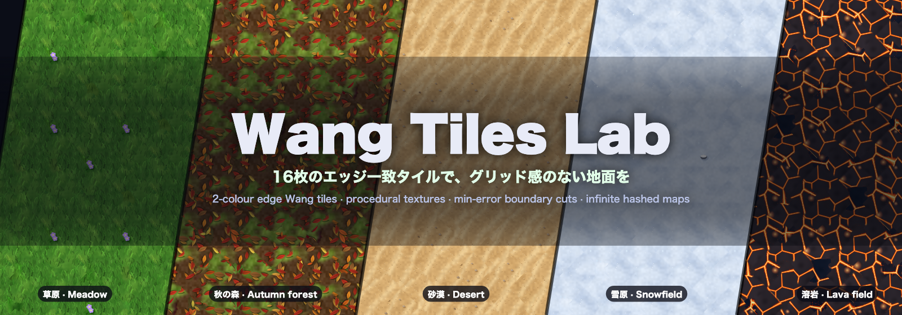

<p align="center">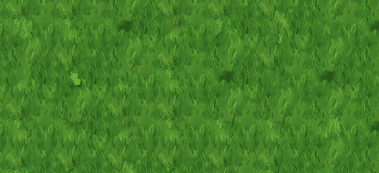<br><sub>Scrolling the infinite hashed map across all 5 themes: no grid, no seams.</sub></p>

**▶ Play in the browser: https://kumi0708.github.io/wang-tiles-lab/**

This demo cuts 16 **2-colour edge Wang tiles** from a seamless texture that the browser generates procedurally. It then tiles the ground with them, and no grid shows.
Based on [SpriteCook — Wang Tiles Explained](https://www.spritecook.ai/blog/wang-tiles-explained). It is plain ES modules and Canvas 2D, with no build step.

## 1. Why Wang tiles?
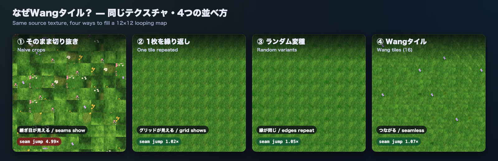

| Fill | Problem |
|---|---|
| ① Naive crops | Neighbouring borders don't continue, so seams show |
| ② One seamless tile repeated | Features repeat every tile, so a grid shows |
| ③ Random variants | Middles differ, but every variant has the same border pixels, so the edges repeat |
| ④ **Wang tiles** | Each edge gets a colour, and tiles only meet where the colours match. No seams, no period |

`seam jump` = colour difference across tile borders ÷ colour difference between adjacent pixels inside tiles. A value near 1.0 means the seams are invisible (`seamStats` in `src/render.js`).

## 2. Store edges, not cells
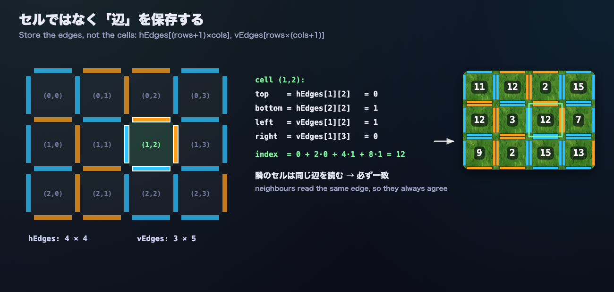

- `hEdges`: `(rows+1) × cols`. `hEdges[r][c]` is the top edge of cell (r,c)
- `vEdges`: `rows × (cols+1)`. `vEdges[r][c]` is the left edge of cell (r,c)
- Each edge is a fair coin flip. Neighbours read **the same edge value**, so they always agree (`src/map.js`)

## 3. Pack into 4 bits
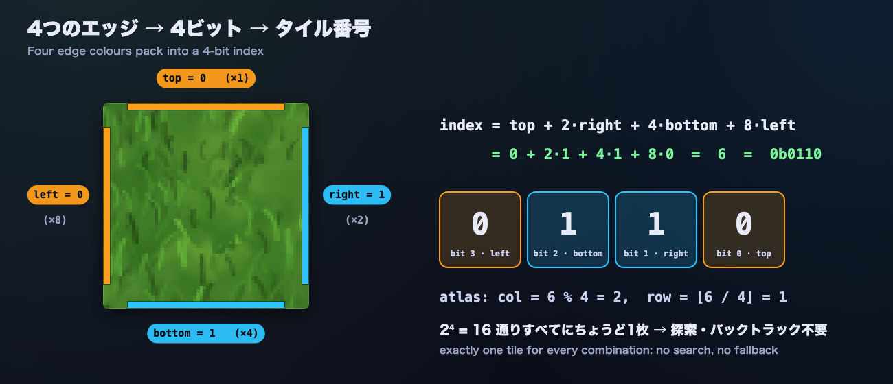

```js
index = top + 2*right + 4*bottom + 8*left   // 0..15
atlasCol = index % 4; atlasRow = Math.floor(index / 4);
```
Each of the 2⁴ = 16 combinations has exactly one tile, so there is no search, no backtracking and no fallback.

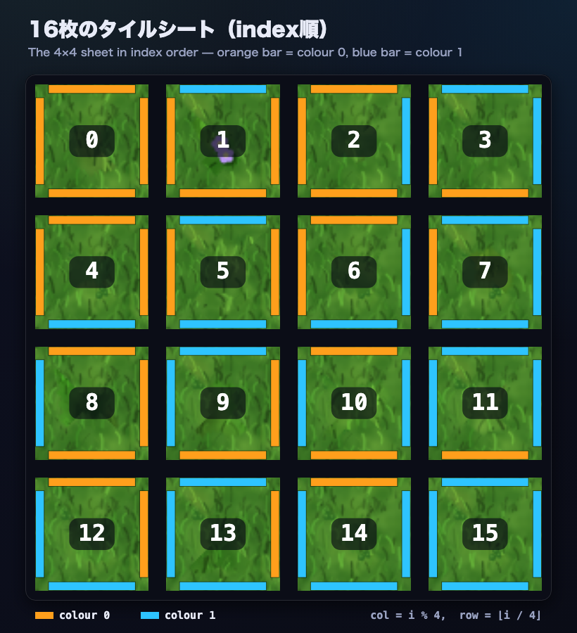

## 4. Building the tiles (`src/wang.js`)
### 4.1 Choosing spots
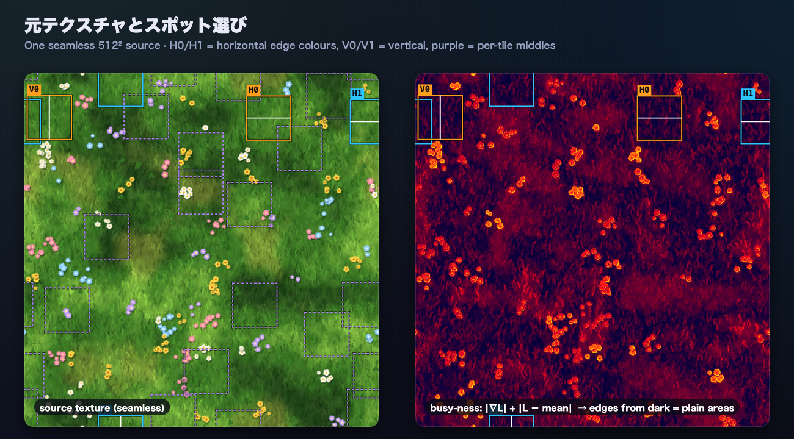

From the 512² source, which is seamless in every direction, the code picks spots: **H0/H1** for horizontal edges, **V0/V1** for vertical edges, and **M0..M15** for the tile middles.
The article advises taking edge strips from plain areas. So "busy-ness" = luminance gradient + distance from the mean colour, averaged over a window with a summed-area table. The least busy candidates become the edge spots.

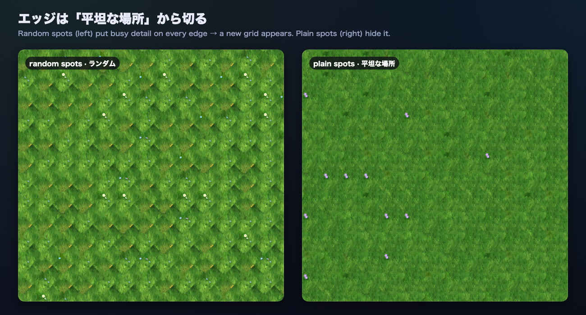

Left: random spots put flowers on the edges, and they line up into a new grid. Right: plain spots.

### 4.2 Same spot on both sides = no seam
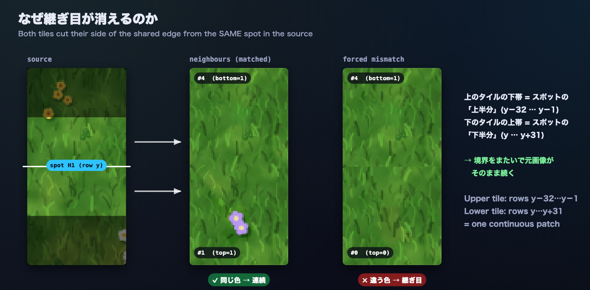

Say the spot for horizontal colour c is (sx, sy). Then:
- the lower tile's **top strip** = source rows `sy … sy+T/2-1`
- the upper tile's **bottom strip** = source rows `sy-T/2 … sy-1`

So the pixels on the two sides of the border are continuous in the source. Left and right edges work the same way. If the colours differ (right), a seam appears.

### 4.3 Stitch 4 strips + middle with a min-error cut
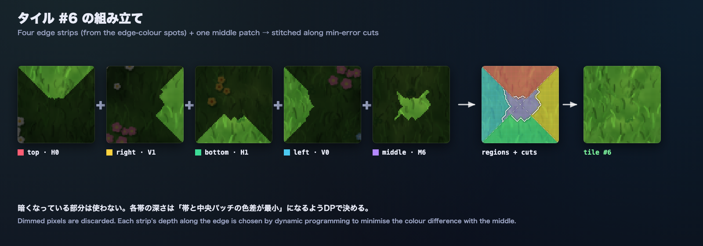

- Each pixel belongs to the triangle of its nearest edge. Along that edge, **dynamic programming** picks the depth `c(u)` where the strip hands over to the middle patch: the minimum error boundary cut from Efros & Freeman's Image Quilting (2001)
- Cost = squared RGB error between the strip and the middle. The path has the lowest total cost subject to `|c(u) - c(u-1)| ≤ 1`
- The cut gets about 1px of feathering, and the diagonal seams are lightly blended. The outermost row always stays pure strip pixels, so continuity with the neighbours is never broken

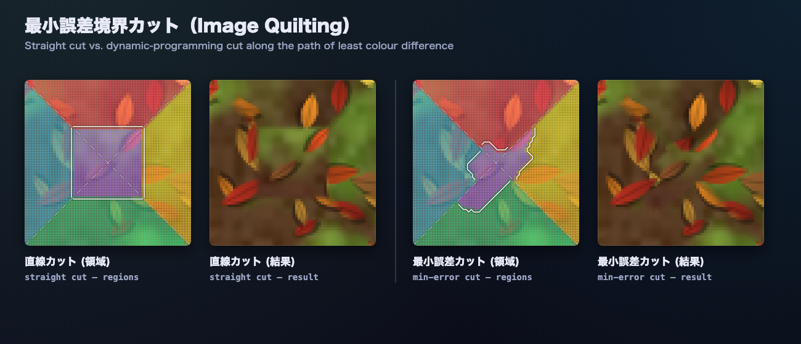

## 5. Map kinds
| Mode | Implementation |
|---|---|
| Finite | `(rows+1)×cols` / `rows×(cols+1)` arrays |
| Loop | `rows×cols` arrays + `% rows`, `% cols` → torus |
| Infinite | No storage: edge = `hash(seed, x, y, H/V) & 1`, so chunks agree without sharing data |

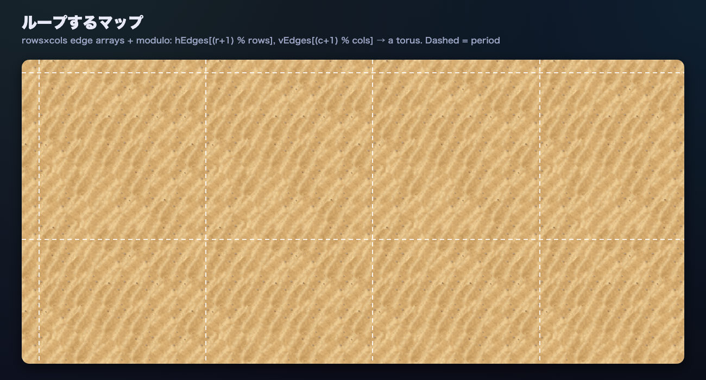
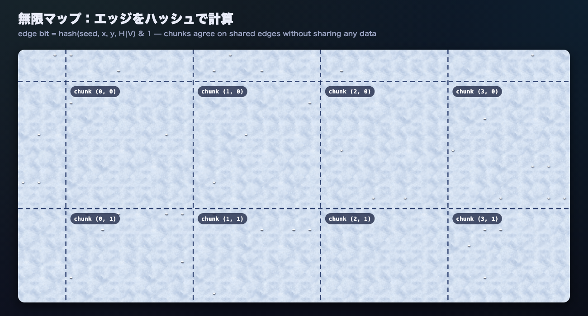

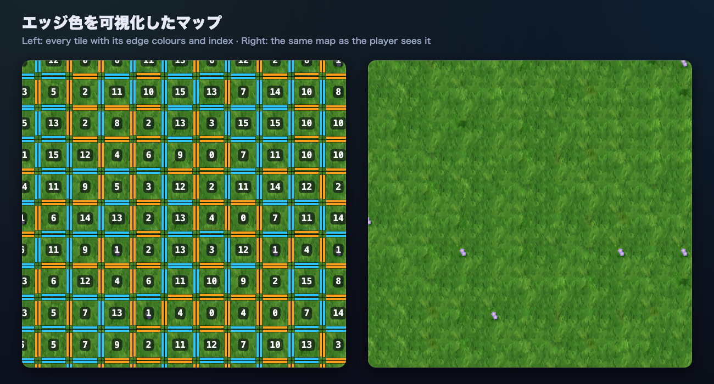

## 6. Procedural textures (`src/texture.js`)
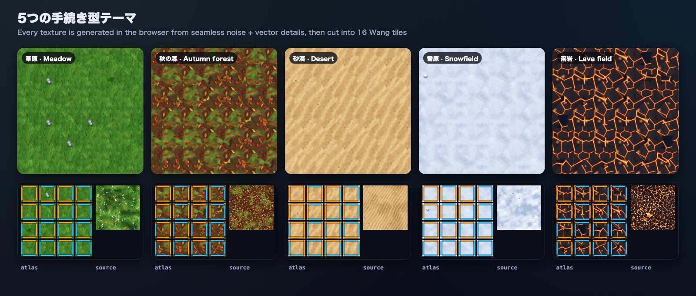

- Periodic value noise, fBm and Worley noise. The lattice wraps with `period`, so the result is always seamless
- On top of the noise, Canvas draws vector details: grass blades, flowers, leaves, pebbles, embers. Near the borders, each shape is drawn again at ±512 px so it wraps
- Five themes: meadow, autumn forest, desert, snowfield and lava. Each one is fully determined by its seed

## 7. App features
- Compare the 4 modes; pick the theme, seed and tile size (48/64/96)
- Overlays: edge colour bars, tile index, grid lines, loop borders
- Click a tile to see how it is built (regions, cut lines, formula); view the source spots and the busy-ness map
- HUD with the edge-match check, seam jump and the number of tiles used
- Save the atlas as a PNG. The app state lives in the URL hash, so you can share a link to it

## Files
```
index.html / style.css     app
src/noise.js               PRNG, hashing, periodic noise
src/texture.js             5 seamless texture themes
src/wang.js                spot selection, min-error cuts, 16-tile build
src/map.js                 edge arrays / hashing → tile index
src/render.js              drawing, overlays, seam statistics
src/main.js, src/i18n.js   UI, JA/EN
figures.html, src/figures.js, scripts/capture.mjs   README figure generation
```

## Run locally
```bash
node scripts/serve.mjs 8791
```
To regenerate the README figures (with the server running; needs Chrome):
```bash
node scripts/capture.mjs
```

## References
- SpriteCook, *Wang Tiles Explained* / *Dual-Grid Tilesets Explained*
- Efros & Freeman, *Image Quilting for Texture Synthesis and Transfer*, 2001
- Cohen, Shade, Hiller, Deussen, *Wang Tiles for Image and Texture Generation*, 2003
