# Wang Tiles Lab

[English](README.en.md) | **日本語**

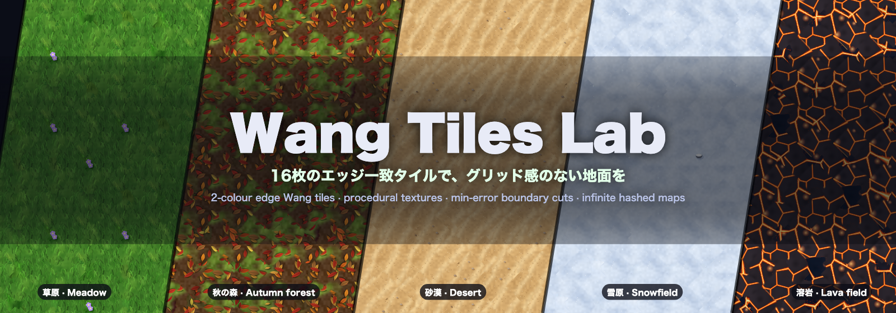

<p align="center">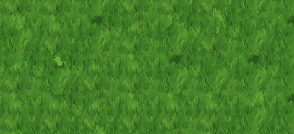<br><sub>無限マップをスクロール（5テーマ）。どこにもグリッドや継ぎ目は見えません。</sub></p>

**▶ ブラウザで遊ぶ: https://kumi0708.github.io/wang-tiles-lab/**

16枚の **2色エッジ Wang タイル** を、ブラウザ内で手続き生成したシームレステクスチャから切り出し、グリッド感のない地面を敷き詰めるデモです。
元ネタ: [SpriteCook — Wang Tiles Explained](https://www.spritecook.ai/blog/wang-tiles-explained)。ビルド不要の素の ES Modules + Canvas 2D で書いています。

## 1. なぜ Wang タイル？
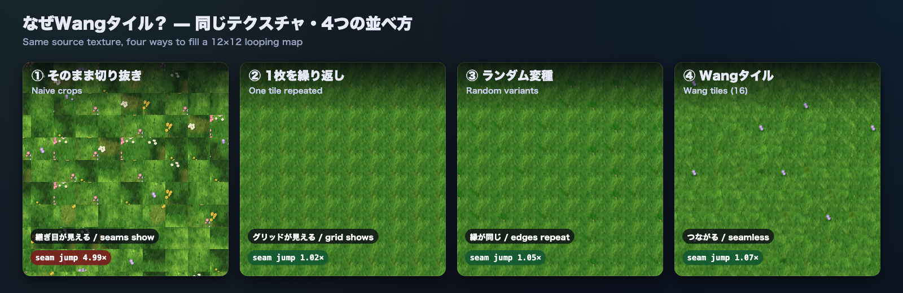

| 並べ方 | 問題 |
|---|---|
| ① そのまま切り抜き | 隣同士の縁がつながらず継ぎ目が見える |
| ② シームレスな1枚を繰り返す | 花などの特徴が1タイル周期で並び、グリッドが見える |
| ③ ランダム変種 | 中央は変わるが、縁の画素が全タイル共通なので縁が繰り返す |
| ④ **Wang タイル** | 辺に色を付け、色が一致する辺同士だけ接続 → 継ぎ目も周期も消える |

`seam jump` は「タイル境界をまたぐ色差 ÷ タイル内部の隣接画素の色差」。1.0 前後なら継ぎ目が見えません（`src/render.js` の `seamStats`）。

## 2. セルではなく「辺」を保存する
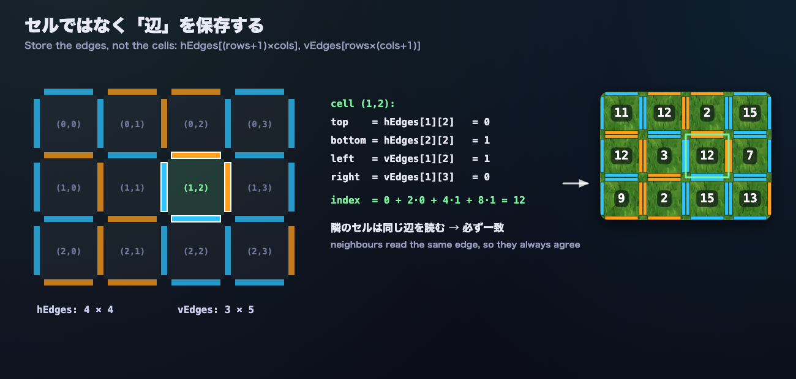

- `hEdges`: `(rows+1) × cols`。`hEdges[r][c]` はセル (r,c) の上辺
- `vEdges`: `rows × (cols+1)`。`vEdges[r][c]` はセル (r,c) の左辺
- 各辺はコイン投げで 0/1。隣接セルは**同じ辺の値を読む**ので必ず一致します（`src/map.js`）

## 3. 4ビットに詰める
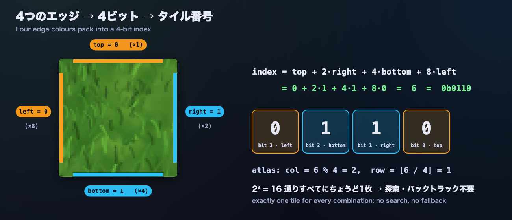

```js
index = top + 2*right + 4*bottom + 8*left   // 0..15
atlasCol = index % 4; atlasRow = Math.floor(index / 4);
```
2⁴ = 16 通りすべてにちょうど1枚のタイルがあるので、探索・バックトラック・フォールバックは不要です。

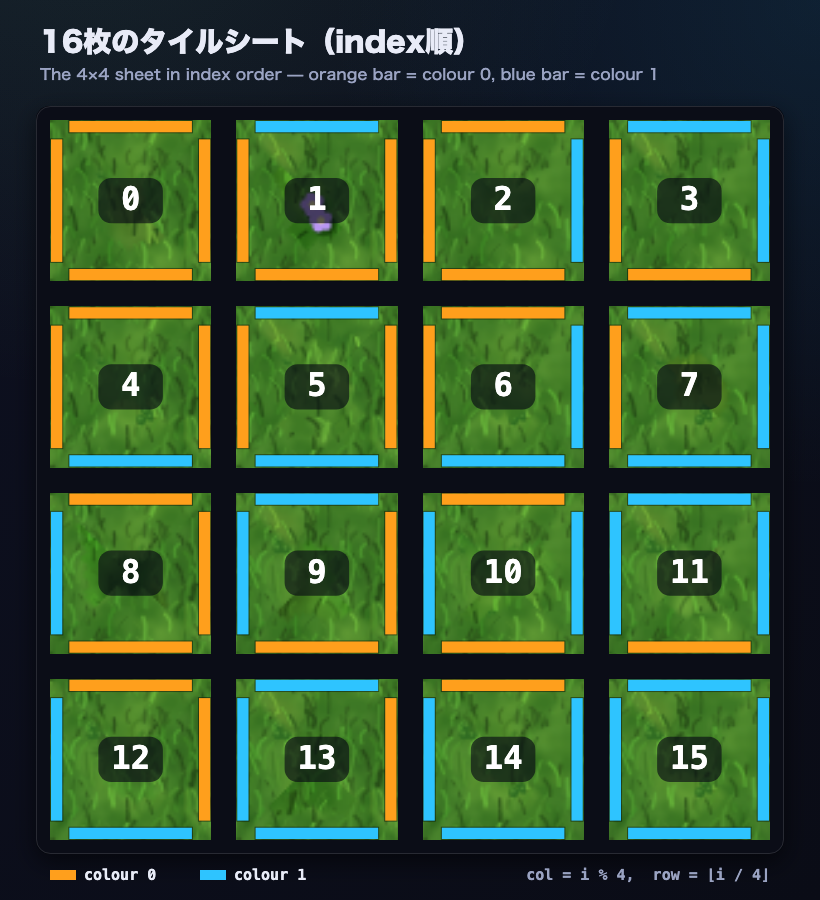

## 4. タイルの作り方（`src/wang.js`）
### 4.1 スポット選び
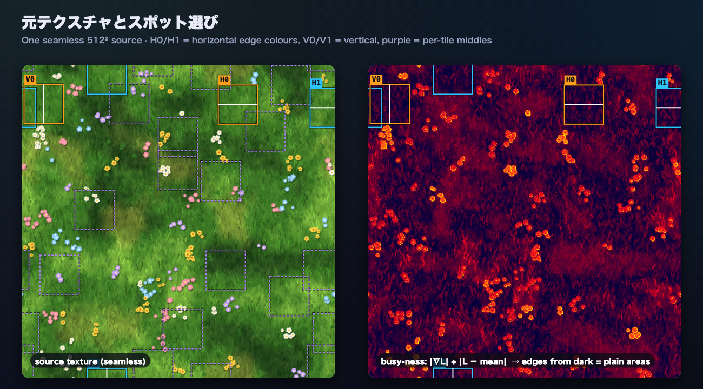

元テクスチャ（512², 全方向シームレス）から、上下辺用 **H0/H1**、左右辺用 **V0/V1**、各タイルの中央用 **M0..M15** の位置を選びます。
記事のアドバイス「辺の帯は平坦な場所から」に従い、輝度勾配 + 平均色からのずれ を「複雑さ（エネルギー）」として summed-area table で窓平均し、エネルギーの低い候補を辺に割り当てます。

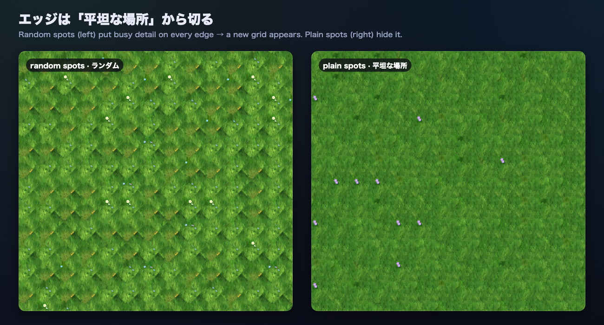

左：ランダムに選ぶと、辺に入った花が格子状に並び、新たなグリッドが現れます。右：平坦な場所を選んだ場合。

### 4.2 同じ場所から切るから継ぎ目が消える
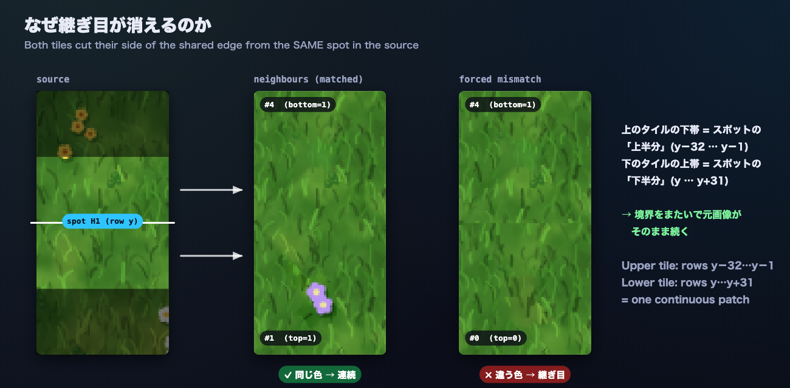

色 c の水平辺のスポットを (sx, sy) とすると
- 下側タイルの**上帯** = 元画像の行 `sy … sy+T/2-1`
- 上側タイルの**下帯** = 元画像の行 `sy-T/2 … sy-1`

つまり境界の両側は元画像で連続した画素です。左右も同様です。色が違うと（右図）継ぎ目が出ます。

### 4.3 4本の帯 + 中央を最小誤差カットで縫う
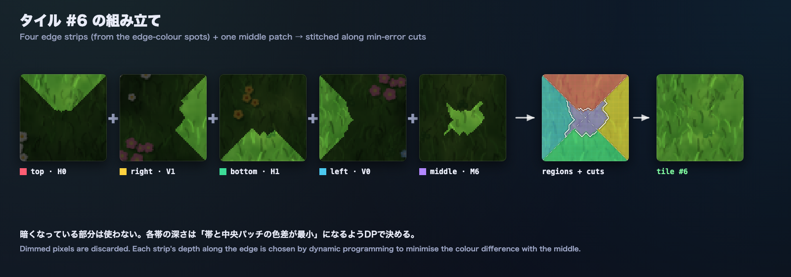

- 各画素は最も近い辺の三角形に属し、そこから中央パッチへの切り替わる深さ `c(u)` を **動的計画法**で決定（Efros & Freeman 2001, Image Quilting の minimum error boundary cut）
- コスト = 帯と中央の RGB 二乗誤差。`|c(u) - c(u-1)| ≤ 1` の経路で総和最小
- カット付近は約1pxフェザー、対角の継ぎ目も軽くブレンド。ただし**外周1行は必ず帯の画素のまま**なので、隣とのつながりは壊れません

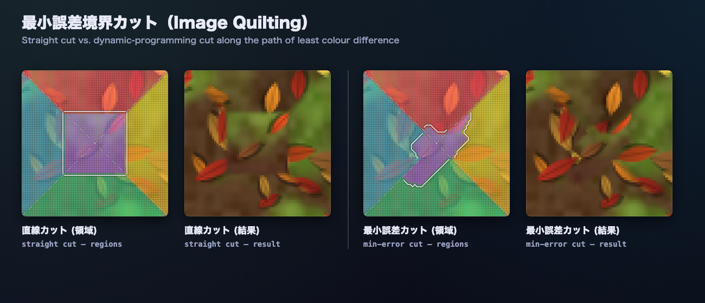

## 5. マップの種類
| モード | 実装 |
|---|---|
| 有限 | `(rows+1)×cols` / `rows×(cols+1)` の配列 |
| ループ | `rows×cols` 配列 + `% rows`, `% cols` でトーラス化 |
| 無限 | 配列を持たず `hash(seed, x, y, H/V) & 1` で辺を計算。チャンク同士がデータ共有なしで一致 |

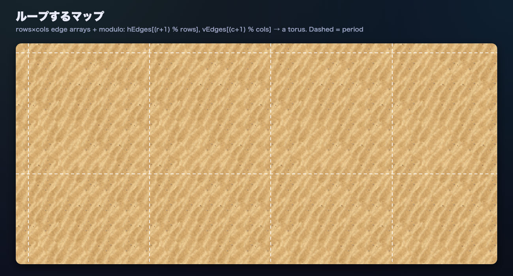
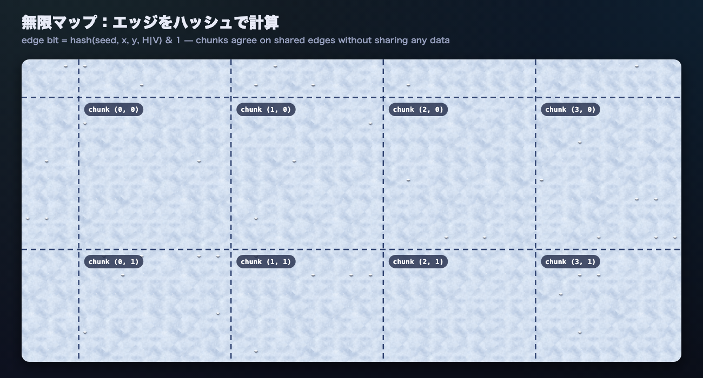

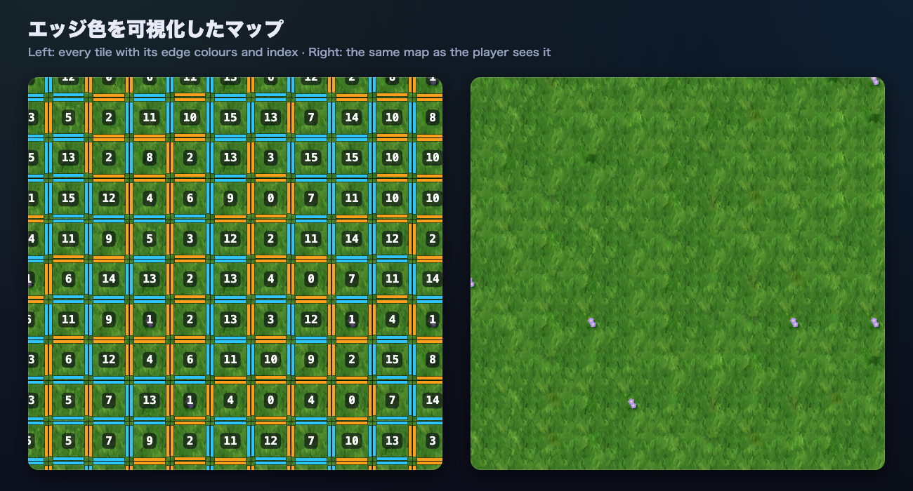

## 6. 手続き型テクスチャ（`src/texture.js`）
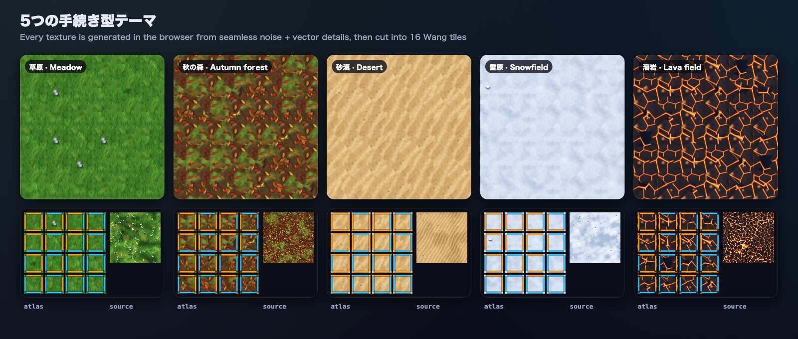

- 周期つき value noise / fBm / Worley noise（格子を `period` で wrap → 必ずシームレス）
- その上に草の葉・花・落ち葉・小石・火の粉などを Canvas でベクタ描画。境界付近は ±512px ずらして重ね描きして wrap
- 草原・秋の森・砂漠・雪原・溶岩の5テーマ。seed で決定的に再現されます

## 7. アプリの機能
- 4モード比較、テーマ・seed・タイルサイズ（48/64/96）
- エッジ色バー / タイル番号 / グリッド / ループ境界のオーバーレイ
- クリックでタイル解剖（領域・カット線・計算式）、元テクスチャのスポットと複雑さマップ
- エッジ一致チェック、seam jump、使用タイル数の HUD
- タイルシートを PNG で保存。状態は URL ハッシュに入るので共有できます

## ファイル構成
```
index.html / style.css     アプリ
src/noise.js               PRNG・ハッシュ・周期ノイズ
src/texture.js             5テーマのシームレステクスチャ
src/wang.js                スポット選択・最小誤差カット・16枚の生成
src/map.js                 辺の配列 / ハッシュ → タイル番号
src/render.js              描画・オーバーレイ・継ぎ目統計
src/main.js, src/i18n.js   UI・日英切り替え
figures.html, src/figures.js, scripts/capture.mjs   README画像の生成
```

## ローカル実行
```bash
node scripts/serve.mjs 8791
```
README の画像を作り直すとき（サーバー起動中に、Chrome が必要です）:
```bash
node scripts/capture.mjs
```

## 参考
- SpriteCook, *Wang Tiles Explained* / *Dual-Grid Tilesets Explained*
- Efros & Freeman, *Image Quilting for Texture Synthesis and Transfer*, 2001
- Cohen, Shade, Hiller, Deussen, *Wang Tiles for Image and Texture Generation*, 2003
